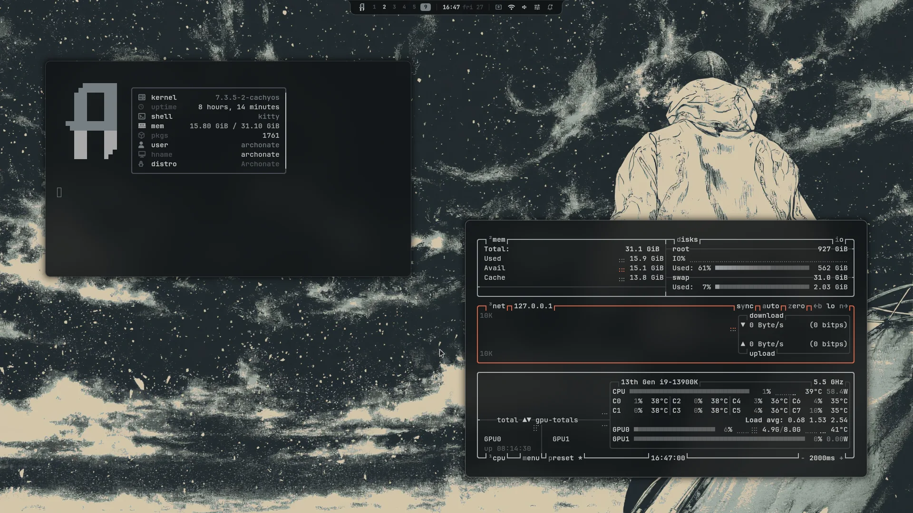
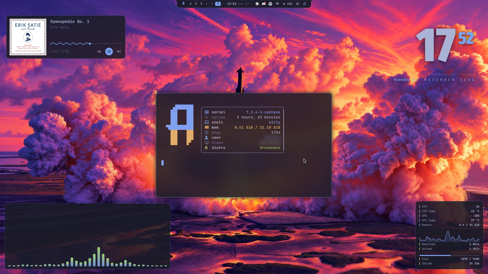
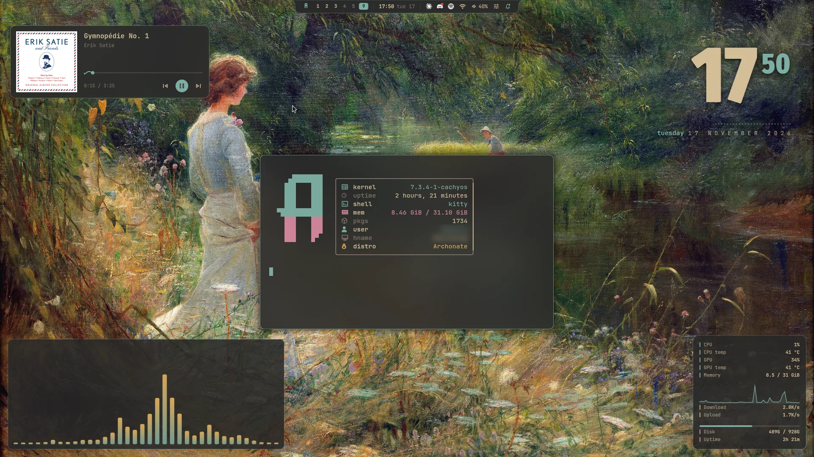
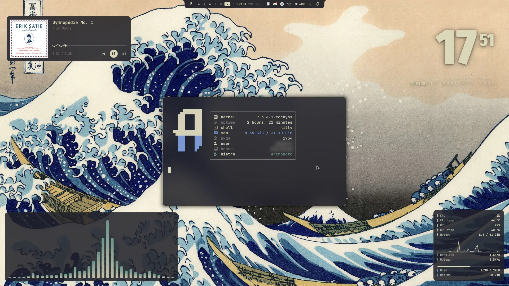
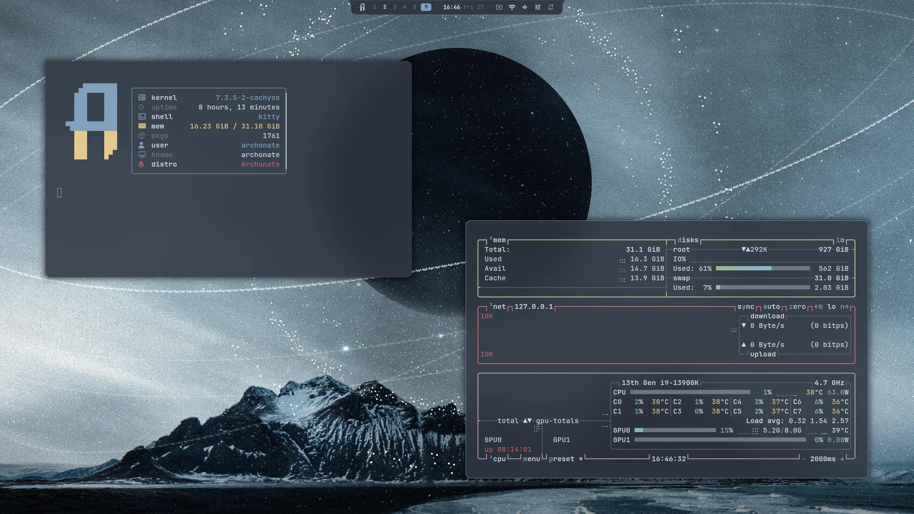
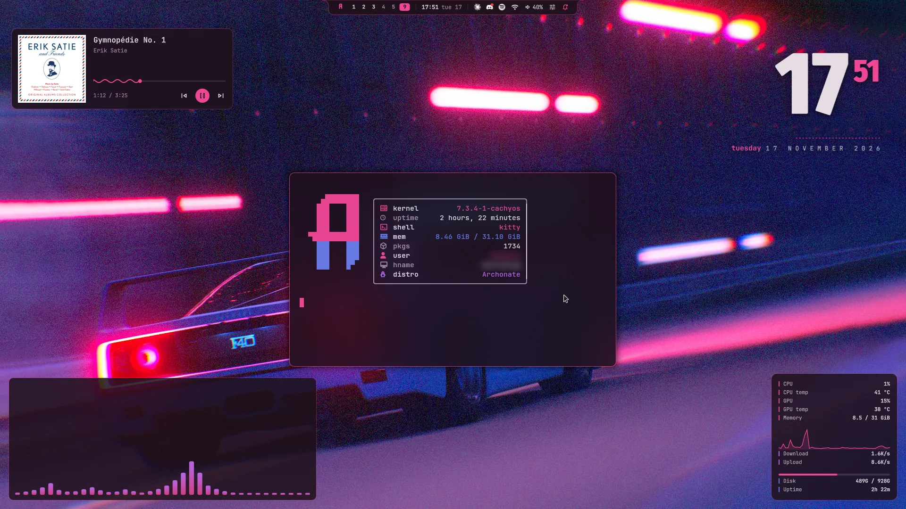
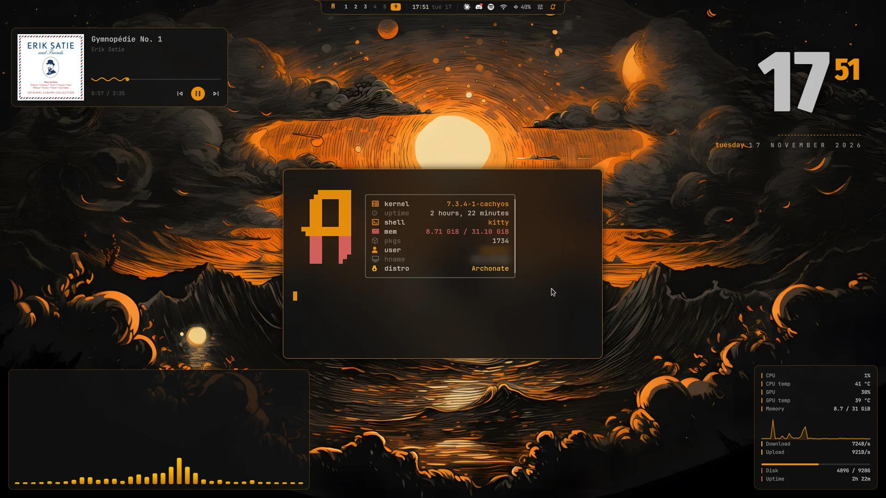

# Archonate



An opinionated Hyprland desktop with one design, and every app dressed to
match it: terminal, file manager, editor, Spotify, Discord, the browser's
toolbar, the login screen.

- **The design**: a notch bar hanging from the top edge over a line that
  ripples with your music, and a living desktop (visualizer, media card,
  poster clock, system stats).
- **Styles**: change its colours and wallpapers in one go. It ships its own
  style, wears any of omarchy's dark themes
  ([omarchy](https://github.com/omacom/omarchy)), or makes one from any
  wallpaper of yours.
- **Modes**: normal, gaming (the bar hides over fullscreen, the desktop goes
  quiet), minimal.
- **Agent-ready**: every coding agent you have (Claude Code, Codex, OpenCode,
  Gemini CLI...) is taught how to drive Archonate by a skill, linked in and kept
  current, so you just ask it. SUPER+A opens yours, a crash comes with an "Ask
  AI why" button, and
  `archonate status --json` gives scripts and agents the whole state.
- **Everything is findable**: a cheat sheet, a searchable menu, a Settings app
  and one command, `archonate`.

Same desktop, other styles (`archonate style set <name>`, or Super + F9):

| | |
| --- | --- |
|  |  |
| tokyo-night | gruvbox |
|  |  |
| kanagawa | nord |
|  |  |
| neon-drive | matte-black |

## Install

On Arch Linux or anything built on it (CachyOS, EndeavourOS, ...):

```bash
mv ~/.config/hypr ~/.config/hypr.bak 2>/dev/null   # keep what you had
git clone https://github.com/TheOhZelly/archonate ~/.config/hypr
~/.config/hypr/install.sh
```

Then log into the **Hyprland (uwsm-managed)** session.

The installer is safe to run again and tells you what it does:

- installs the packages (it offers to set up `paru` if you have no AUR helper),
- asks before installing optional apps (a browser or editor if you have none),
- backs up `~/.zshrc` and `kitty.conf` before adding its lines to them,
- creates `user.lua` for your own settings, which updates never touch.

It needs a btrfs + snapper system only for snapshots before updates, and
CachyOS only for `cachy-update`; without them those steps are skipped.

## First five minutes

| Key | What it does |
| --- | --- |
| **Super + /** | The cheat sheet: every shortcut, searchable |
| **Super + Escape** | The menu: styles, wallpapers, modes, settings, install apps |
| **Super + F9** | Pick a style, with previews |
| **Super + I** | Settings |
| **Super + Return** | Terminal |
| **Super + W** / **E** / **Shift + E** | Your default browser, file manager, editor |
| **Super + Q** | Close the window |
| **Super + A** | Your coding agent, which already knows Archonate: just ask |

The cheat sheet opens by itself the first time you log in.

Nothing needs the mouse. **Settings** opens in its search box: type to jump to
a page (it opens as you type), **Up/Down** walk the pages, **Enter** or **Tab**
go into the page, **Tab** moves between controls, **Space** presses them,
arrows move sliders, **Esc** steps back and then closes. **Ctrl + Tab**
switches page from anywhere. The quick panels (**Super + K**) work the same:
**Tab** through them, **Space** to flip, **Right** on a tile for its details.

## The `archonate` command

Everything the keys and menus do, from a terminal. Run it bare for the logo
and the full list, or `archonate help <group>` for one group.

```bash
archonate style set gruvbox             # other colours and wallpapers (style list, pick)
archonate style from ~/Pictures/x.jpg   # a new style made from any wallpaper
archonate mode set gaming               # normal, gaming, minimal
archonate toggle nightlight             # dnd caffeine gaming widgets shader screensaver
archonate wallpaper pick                # wallpaper switcher (also next, prev)
archonate settings wifi                 # the Settings app, at a page
archonate install gaming                # install or remove apps by section
archonate update                        # snapshot, then update everything
archonate doctor                        # check that everything works
archonate status --json                 # the whole desktop's state, for scripts and agents
```

## AI

Archonate gets along with AI coding agents without depending on any:

- `archonate agent` (SUPER+A) opens the agent you use; `archonate agent default`
  picks among the ones installed. `archonate install ai` adds some.
- When a program crashes, the notification has **Ask AI why**: the agent reads
  the crash report and says what happened and whose bug it is.
- Every agent you have learns Archonate through two skills, `archonate` (how to
  drive this desktop, rebuilt from the commands on every update) and
  `archonate-diagnose-crash`. They are links in each tool's skills folder;
  `archonate agent skills off` removes them and keeps them off.

## Making it yours

- **`user.lua`**: your own keys, keyboard layouts and autostart. Loaded last,
  ignored by git. `user.lua.example` shows the common ones.
- **Default apps**: Settings > Default apps. The app keys open whatever is
  set there.
- **Wallpapers**: each style brings its own; `archonate style from <image>`
  makes a style from yours. Switch with Super + Ctrl + W.
- **Day and night**: Settings > Day & night switches style by time of day.
- **Hooks**: scripts in `~/.config/archonate/hooks/<event>.d/` run on
  theme-set, mode-set, style-set, toggle, post-update and post-boot.

Optional, system-level, each run by hand and each undoable (the installer
prints them): the ARCHONATE login screen (SDDM), the Brave toolbar following
the rice, and on CachyOS calling the system "Archonate Linux".

## If something is off

```bash
archonate doctor
```

It checks packages, fonts, the shell, the QML and the config, and says what to
run to fix each thing it finds.

## How it's built

- `hyprland.lua` loads the shared behaviour (`standalone/init.lua`,
  `hyprland/`), the active rice (`rices/<name>/theme.lua`), `common.lua`,
  the active mode (`modes/<mode>.lua`) and last your `user.lua`.
- `rices/<name>/`: `theme.lua` (the Hyprland look), `desktop.json` (the
  palette: the one place a rice's colours live), `shell/` (its Quickshell
  desktop: Bar + Theme), `fuzzel.ini`, `assets/` (wallpapers, sounds, logo).
- `qs-common/`: what every rice's shell shares: wallpaper, notifications,
  OSD, lock, screensaver, quick panels, the menu, the cheat sheet.
- `lib/desktop.py`: swaps rices and themes the apps from `lib/templates`.
  `lib/archonate/`: the CLI and its commands.
- `settings/`, `picker/`, `wallswitch/`, `login/`: the Settings app, the rice
  picker, the wallpaper switcher, the SDDM theme.
- Your choices live outside the repo, in `~/.local/state/hypr-rice/` and
  `~/.local/share/archonate/`.

## Credits and licence

Archonate is free software under the [GPL-3.0](LICENSE).

- The Hyprland base config (`hyprland/`, `variables.lua`) and the app colour
  templates in `lib/templates` are adapted from
  [caelestia](https://github.com/caelestia-dots) (GPL-3.0).
- The idea of one command and one menu for the whole desktop, and the
  styles archonate wears, come from [omarchy](https://github.com/omacom/omarchy)
  (MIT). Its themes are downloaded at install time, not redistributed here.
- The ARCHONATE logo is set in the FIGlet font "Delta Corps Priest 1" by
  CoSMiC cHiLD.
- Every sound is synthesised by `lib/archonate/make-sounds.py`; nothing is
  sampled.
- Wallpapers come with the styles; the built-in style's is drawn in code.
  Details: [WALLPAPERS.md](WALLPAPERS.md).
